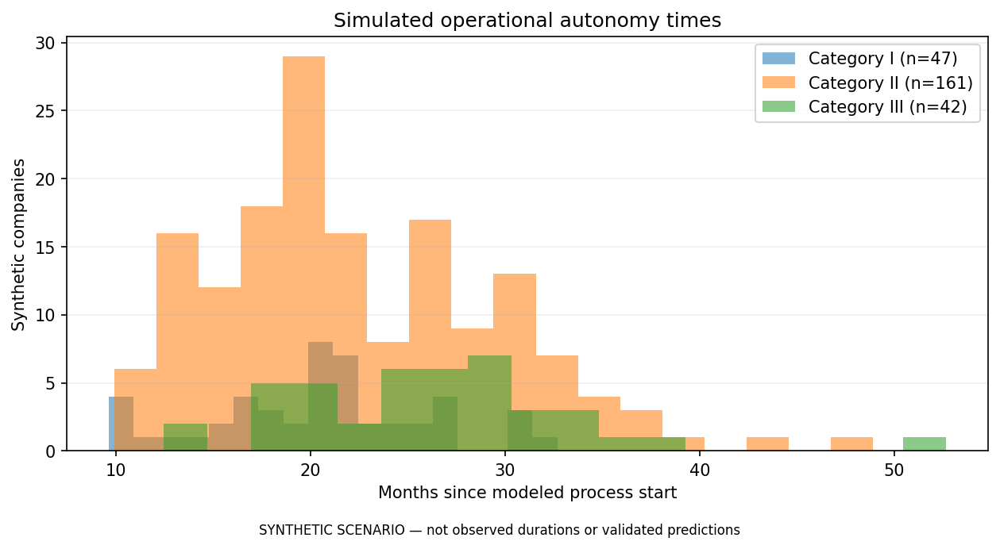
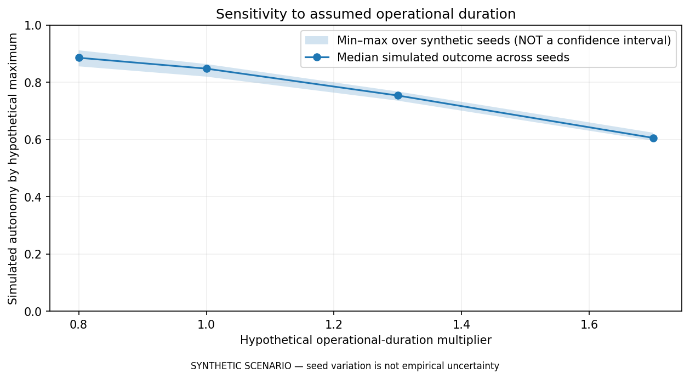

# Corporate Restructuring Simulator

**Python · Discrete-event simulation · Monte Carlo · SQLite · Data analysis**

[](https://github.com/ErubielG/corporate-restructuring-simulator/actions/workflows/tests.yml)

A reproducible computational experiment that explores how **legal approvals, buyer search, operational dependencies, transitional services, and unexpected incidents** can affect hypothetical corporate restructuring timelines.

> **Important:** All company profiles, delays, probabilities and deadlines in this public demonstration are **synthetic assumptions**. Its outcomes are **not real-world forecasts**, legal compliance rates or policy recommendations.

## Why this project?

An order to divest a business does not immediately imply a legal sale, and a legal sale does not necessarily establish full operational independence. This simulator investigates that difference with an event-driven process model.

The project is an independent software/data-science exercise derived from the broader *Sistemas y Sociedad* research initiative. The historical research material is **not included** here.

## What it demonstrates

| Area | Implementation |
|---|---|
| Simulation engineering | Priority-queue discrete-event engine; task dependencies; event interruption and rescheduling |
| Probabilistic methods | Seeded sampling and Monte Carlo cohorts with configurable assumptions |
| Data engineering | JSON inputs, SQLite data-interface fixture, CSV outputs, JSON event traces and SHA-256 provenance |
| Data analysis | Reproducible descriptive summaries, duration distributions and sensitivity plots |
| Software quality | Regression tests, deterministic examples and automated CI on Python 3.10 and 3.12 |

**Core engine:** Python 3.10+ and the standard library. **Optional analysis tools:** Pandas, Matplotlib and JupyterLab.

## Quick start

Clone the repository and run these commands from its root:

```bash
python -m unittest discover -s tests -v
python scripts/make_synthetic_fixture.py --out data/synthetic_demo_fixture.sqlite
python -m v3sim.dynamic_cli --config config_demo_synthetic.json --atlas data/synthetic_demo_fixture.sqlite --out output/demo --trace-limit 5
python scripts/analyze_demo.py --input output/demo/empresas_resultados.csv --out output/demo/category_summary.csv
```

The SQLite fixture contains **zero historical cases**; it exists solely to satisfy the simulation engine's data-interface and provenance checks. The `SYNT-*` rows are all generated by the simulator.

### Run an optional sensitivity study and generate figures

Install the *optional* analysis dependencies:

```bash
python -m pip install -r requirements-analysis.txt
```

Then run:

```bash
python -m v3sim.dynamic_analysis --config config_demo_synthetic.json --atlas data/synthetic_demo_fixture.sqlite --out output/sensitivity --scales 0.8 1.0 1.3 1.7 --seeds 20261012 20261013 20261014 20261015
python scripts/plot_results.py --companies output/demo/empresas_resultados.csv --sensitivity output/sensitivity/barrido_v32.csv --out figures
```

For interactive exploration:

```bash
jupyter lab
```

Open notebooks in the `notebooks/` folder **after generating the outputs** using the commands above.

### Figures from the included *synthetic* scenario





These plots describe artificial experiment outputs. The sensitivity shaded area is a min–max range across selected random seeds, **not a confidence interval for real firms**.

## Repository map

```text
v3sim/             Original V3.2.1-I03 Python simulation modules
config_*.json      Versioned synthetic scenario assumptions
scripts/           SQLite fixture, aggregation and plotting
notebooks/         EDA and scenario sensitivity walkthroughs
tests/             Synthetic-only automated software tests
examples/          Small pre-generated CSV/JSON demonstration
figures/           Charts generated from synthetic outputs
docs/              Modeling decisions, methodology and limitations
.github/workflows/ Automated demo verification
```

The event-driven implementation lives in [`v3sim/dynamic_engine.py`](v3sim/dynamic_engine.py). The optional I03 extreme-case extensions are in [`v3sim/i03_pathways.py`](v3sim/i03_pathways.py).

## Research provenance and model limitations

The private research Atlas historically included **63 case records** and **23 precisely dated divestiture-sale durations**, primarily from the UK. Those data are neither redistributed nor used to calibrate this public demo. There are **no sufficiently verified paired observations of sale and complete operational autonomy** for a reliable calibration of the operational phase.

- A simulated `autonomy_by_maximum` value only measures synthetic profiles meeting an **assumed** timeline threshold.
- Event probabilities and organizational complexities are hypothetical, not fitted population parameters.
- Repeated Monte Carlo runs quantify sampling variability **given the assumptions**, not uncertainty about whether the assumptions are true.
- This project contains **no trained predictive ML model**. Predictive modeling is a possible later exercise and would first require meaningful evaluation criteria.

For details see [Modeling decisions](docs/DESIGN_DECISIONS.md), [Methodology](docs/METHODOLOGY.md) and [Limitations](docs/LIMITATIONS.md).

## Testing and reproducibility

```bash
python -m unittest discover -s tests -v
```

The public tests run without historical data. The separate private research package reported **87 passing tests**, but this public repo cannot claim those tests were reproduced without the research Atlas. Fixed seeds, configuration files and output manifests make the demonstration repeatable.

## Development roadmap

- [x] Preserve original public-safe discrete-event engine
- [x] Add synthetic fixture, standalone tests and GitHub Actions
- [x] Add descriptive analysis, notebooks and scenario sensitivity visualizations
- [x] Document mathematical assumptions and validity limits
- [ ] Extend adverse-event tests and profile performance
- [ ] Evaluate a separate, carefully scoped predictive-modeling experiment
- [ ] Research external validation datasets with rights/provenance checks

## License and authorship

Source code and original documentation in this repository are distributed under the [MIT License](LICENSE). Third-party source documents and the separate private research Atlas are **not** covered or distributed here.

Developed as a human-directed research and software-engineering exercise with AI-assisted implementation and technical review. Please independently verify any results before using the model outside education or exploratory analysis.
