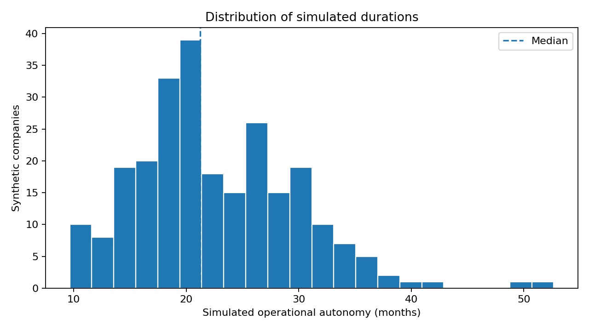
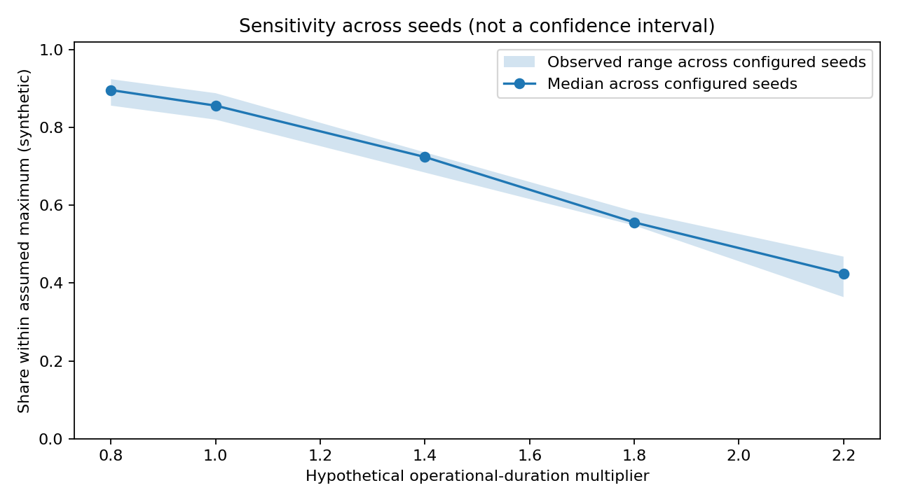

# Corporate Restructuring Simulator

**Python · Discrete-event simulation · Monte Carlo · SQLite · Data analysis**

A reproducible experimental simulator of hypothetical corporate restructuring timelines.
The model distinguishes **legal control transfer** from **operational independence**, while
representing dependencies and events such as regulatory delays, buyer withdrawal, technical
failures, and transitional services.

> **Research integrity:** Public scenarios contain **only synthetic companies and hypothetical
> parameters**. Simulated time-to-autonomy and rates are *not* validated forecasts, observed
> legal compliance rates, or evidence that a particular economic policy would work.

## What the project demonstrates

- **Simulation engineering:** a dynamic discrete-event engine built with `heapq`,
  explicit task dependencies and a traceable event log.
- **Stochastic methods:** synthetic Monte Carlo cohorts, fixed seeds, uncertainty and
  parameter-sensitivity experiments.
- **Data engineering:** optional SQLite adapter, JSON configuration, CSV exports and
  SHA-256 provenance checks.
- **Data science:** reproducible exploratory analysis and visualizations of *synthetic*
  outputs, including variability across repeated runs.
- **Software quality:** unit tests and GitHub Actions on Python 3.10 and 3.12.

## Quick start

Python 3.10+ is required. The core simulator and unit tests use the Python standard library.
Run from the repository root:

```bash
python -m unittest discover -s tests -v
python scripts/make_synthetic_fixture.py --out data/synthetic_demo_fixture.sqlite
python -m v3sim.dynamic_cli --config config_demo_synthetic.json --atlas data/synthetic_demo_fixture.sqlite --out output/demo --trace-limit 5
python scripts/analyze_demo.py --input output/demo/empresas_resultados.csv --out output/demo/category_summary.csv
```

The generated SQLite file is **empty by design**: it provides a compatible schema and
provenance interface but contains zero historical business cases or observed sale durations.
It is not the private research Atlas.

### Optional data-analysis tools

```bash
python -m pip install -e ".[analysis]"
python -m scripts.run_sensitivity --config config_demo_synthetic.json --out output/sensitivity/sensitivity.csv
python -m scripts.plot_synthetic --companies output/demo/empresas_resultados.csv --sensitivity output/sensitivity/sensitivity.csv --out figures
jupyter lab
```

See `notebooks/01_exploratory_analysis.ipynb` and
`notebooks/02_monte_carlo_sensitivity.ipynb` for guided exercises.

### Visual results (synthetic only)

**Distribution of simulated operational-independence times**



**Sensitivity across configured random seeds — NOT a confidence interval**



These visualizations are generated from the provided baseline config. They reflect model
assumptions and must not be interpreted as measured outcomes for real companies.

## Architecture

```text
config_demo_synthetic.json
      │
      ▼
 v3sim.dynamic_cli ─── SQLite fixture (no historical records)
      │
      ▼
 v3sim.dynamic_engine
      ├── task dependency graph
      ├── priority event queue and rescheduling
      ├── hypothetical incidents and outcomes
      └── causal event traces
      │
      ▼
 CSV outcomes + JSON traces + SHA-256 provenance
      │
      ▼
 notebooks / sensitivity experiments / figures
```

`v3sim/` contains the **original 16 Python modules** from the V3.2.1-I03 experimental
research package. The `scripts/`, `notebooks/` and `tests/` material provide the public,
synthetic-only analysis layer. Core simulation rules were not modified for this release.

## Where to look first

| Folder / file | Purpose |
|---|---|
| `v3sim/dynamic_engine.py` | Dynamic event scheduling and state changes |
| `v3sim/engine.py` | Synthetic entity and stage duration generation |
| `v3sim/dynamic_config.py` | Configuration validation and parameter mapping |
| `scripts/make_synthetic_fixture.py` | Empty SQLite interface for public execution |
| `scripts/run_sensitivity.py` | Parameter sweeps with repeated synthetic seeds |
| `scripts/plot_synthetic.py` | Reproducible figures |
| `tests/` | Tests runnable without the private Atlas |
| `docs/MATHEMATICAL_MODEL.md` | Model assumptions, formulas and engineering decisions |
| `docs/LIMITATIONS.md` | Explicit empirical and legal limitations |

## Reproducibility and tests

All stochastic experiments use configurable fixed seeds. A fresh clone can reproduce the
demo without external data access. The public automated tests are **self-contained**.
The private research package has an additional Atlas-dependent test suite that is **not**
shipped here; no claim is made that CI validates the private corpus.

## Research origin and limits

This is a portfolio-oriented derivative of **Sistemas y Sociedad**, an independent
interdisciplinary investigation of economic concentration, institutional oversight and
restructuring procedures. The broader offline documentary Atlas contains 63 case records,
mainly from UK competition proceedings; those records are intentionally not published here.
They do **not** provide sufficiently validated sale-to-full-autonomy time pairs for
calibrating the public operating timelines.

The system does **not** estimate real-world probabilities of successful separation, or
model market equilibrium, prices, employment, innovation or social welfare.
The research questions and verification criteria were human-directed, with AI-assisted
implementation, code review and documentation. See `docs/LIMITATIONS.md` for details.

## Future work

- [x] Publish the original engine and reproducible synthetic demo.
- [x] Add standalone tests and CI.
- [x] Add visual exploratory analysis and sensitivity experiments.
- [x] Document mathematical assumptions and provenance limitations.
- [ ] Add diagnostic stress tests for very long-tail and concurrent events.
- [ ] Improve statistical evaluation and input-data provenance.
- [ ] Study predictive modeling only after defining a justified validation design.

## License

MIT License. See [`LICENSE`](LICENSE). The private Atlas and third-party source documents
are **not included** and are **not licensed** by this repository.
